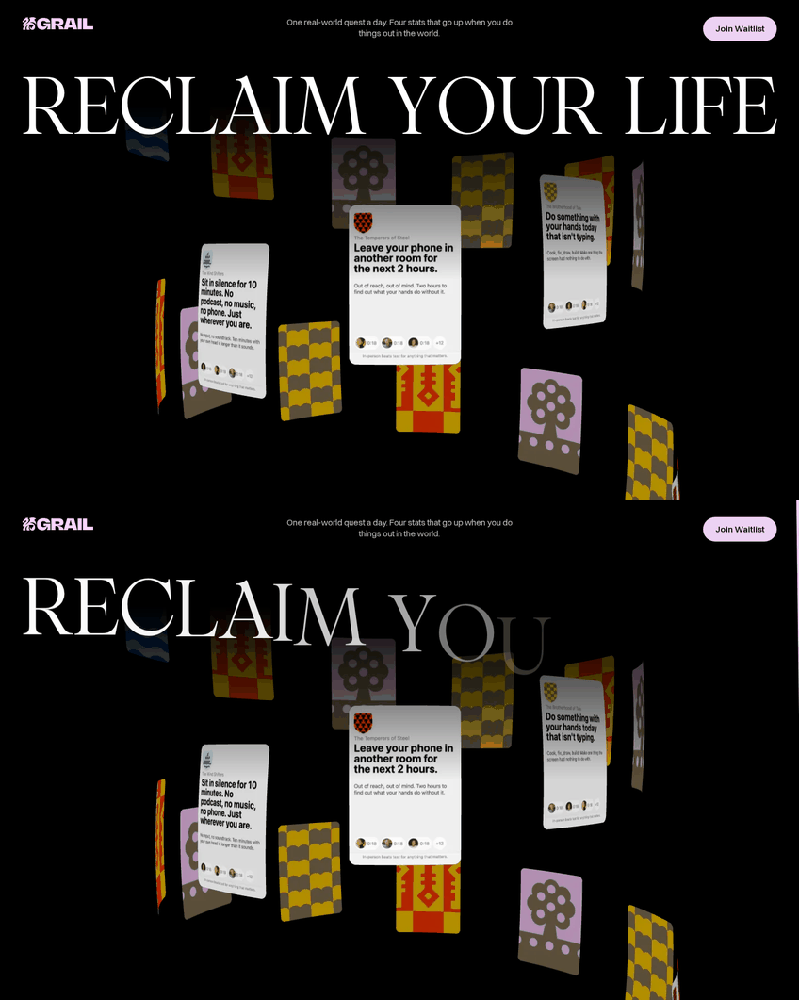
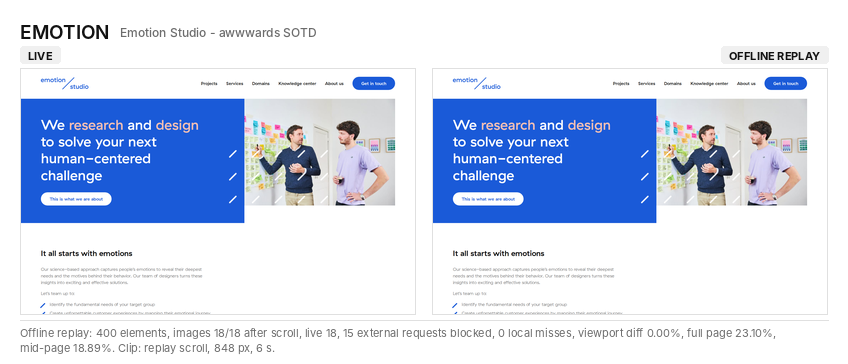

<p align="center">
  
</p>
<h1 align="center">design-extractor</h1>
<p align="center">Capture a website's source, runtime behavior, and design tokens into an offline reference an agent can rebuild.</p>
<p align="center">
  <a href="https://github.com/alfar1zi/design-extractor/actions/workflows/ci.yml"></a>
  
  <a href="./LICENSE"></a>
</p>

<p align="center"></p>

The proof capture is `teenage.engineering` at `1440x900`: 86 files / 4.0 MB,
0 missing, 0 blocked. Live: 1285 elements and 5/13 images. Replay: 733 elements,
4/12 images, 1 external request blocked (`cdn.fonts.net`), and 0 local misses.
The live and replay viewports have 0 changed pixels (`0.0000%`, same MD5).

### Gallery: Awwwards Nominees

Replay fidelity tested across real-world modern web nominees with full off-origin network blocking:

| Nominee | DOM Elements | Images (Replay/Live) | Blocked Off-Origin | Local Misses | Viewport Diff | Offline Replay |
| --- | --- | --- | --- | --- | --- | --- |
| [grail-app.com](https://grail-app.com/) | 615 | 28 / 28 | 4 | 0 | 0.35% | [Video](assets/gallery/grail-app.mp4) |
| [emotion.studio](https://emotion.studio/) | 400 | 18 / 18 | 0 | 0 | 0.00% | [Video](assets/gallery/emotion-studio.mp4) |

<p align="center"></p>
<p align="center"></p>

## Workflow

```bash
node scripts/cli.mjs https://teenage.engineering
```

One command. No flags. The capture lands in `./refs/teenage.engineering` and the
last line of output is the absolute path - hand that path to your agent and it
reads the screenshots, the tokens and the offline tree.

A second capture of the same site never overwrites the first: it writes
`teenage.engineering-2` (then `-3`, and so on). `--force` replaces a folder
instead, when that is what you meant.

<p align="center">
  <picture>
    <source media="(prefers-color-scheme: dark)" srcset="assets/pipeline-dark.svg">
    <source media="(prefers-color-scheme: light)" srcset="assets/pipeline.svg">
    
  </picture>
</p>

The default pipeline runs the local browser capture. `--legacy-source` is opt-in and
POSTs the URL to the third-party `copier.saveweb2zip.com`. MCP is not shipped:
long browser captures and folder artifacts do not fit a useful stateless contract.

## Output

| Path | Contents |
| --- | --- |
| `live/tree/` | Rewritten tree that opens offline |
| `live/screenshots/` | Full-page, scroll, tablet, and mobile captures |
| `live/dom.html` | Post-hydration DOM |
| `live/tokens.json` | Named and resolved CSS tokens plus color schemes |
| `live/motion.json` | Observed and declared motion tracks |
| `live/interactions.json` | Click results and navigation observations |
| `live/hover.json`, `live/states.json` | Hover and pseudo-state evidence |
| `live/a11y-tree.json` | Accessibility tree |
| `live/network.json`, `live/manifest.json` | Requests and artifact index |
| `live/unproducible.json` | Canvas, video, missing asset, and other limits |

## Install

**Agent skill**

```bash
npx skills add alfar1zi/design-extractor
```

**Claude Code plugin**

```text
/plugin marketplace add alfar1zi/design-extractor
/plugin install design-extractor@design-extractor
```

**CLI from a clone**

```bash
git clone https://github.com/alfar1zi/design-extractor.git
cd design-extractor
npm install
npm run install:browsers
node scripts/cli.mjs https://example.com
```

The CLI is available from a clone today. `npx design-extractor` will work after the package is published with `npm publish`.

## Usage

The URL is the whole command. Flags exist for the cases that need them and are
never required:

```bash
node scripts/cli.mjs https://example.com --target ".hero" --out ./refs/hero
```

`--target <css>` (repeatable) adds `targets.json` (per-element capture) and
scopes tokens, components and motion analysis to the matched selectors; the
tree, screenshots and accessibility tree stay whole-page. `--out <dir>` writes
somewhere other than `./refs/<host>`. `--viewport 1440x900`, `--timeout 30`, `--quick`, `--full`,
`--sourcemap`, `--no-scroll`, `--no-interactions`, `--no-sweep`, `--no-states`
and `--allow-private` are there when the default run is not what you want; run
`--help` for the list.

## Limits

| Captured | Boundary |
| --- | --- |
| HTML, CSS, JS, images, fonts | Source download is third-party and opt-in |
| DOM, accessibility tree, tokens | Post-hydration state only |
| Clicks, hovers, pseudo-states | SPA hydration and shadow widgets can remain unobserved |
| Scroll screenshots and motion | Scroll-linked motion is sampled at discrete positions |
| Canvas, WebGL, video, auth-gated regions | Named in `unproducible.json`, not reconstructed as DOM/CSS |
| Fidelity score | Same browser, viewport, and device scale factor are required |

## Links

| Resource | Path |
| --- | --- |
| Agent skill | [`skills/design-extractor/SKILL.md`](skills/design-extractor/SKILL.md) |
| Security policy | [`SECURITY.md`](SECURITY.md) |
| License | [`LICENSE`](LICENSE) |

Contributor convention: run `node --test` or `npm test`, `npm run lint`, and
`npm run validate` before submitting. Use ESM, and add no dependency without a reason.
