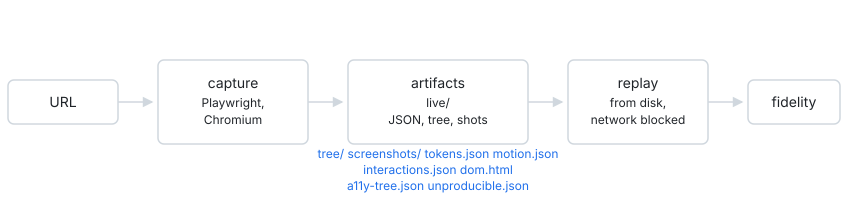
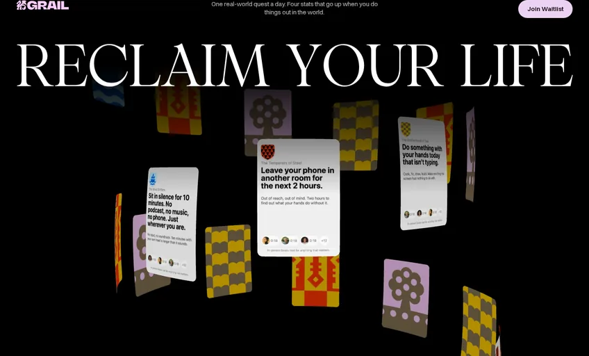
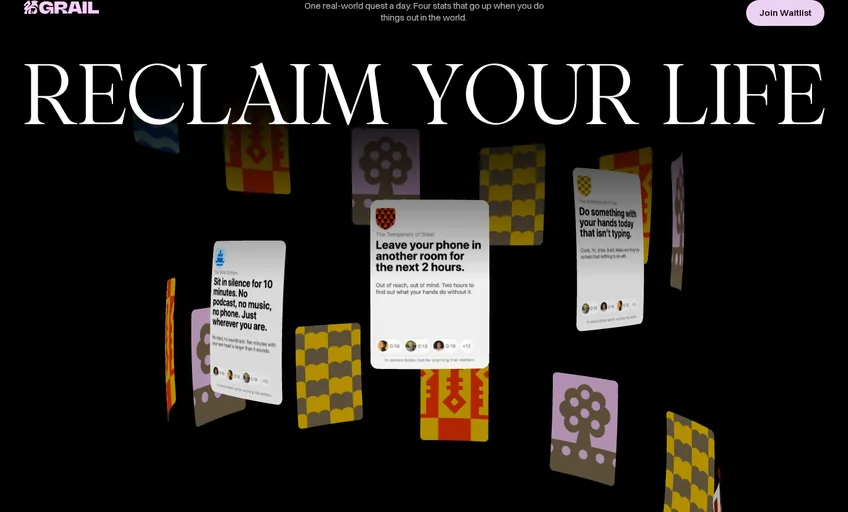

<p align="center">
  
</p>

<div align="center">

<a href="https://github.com/alfar1zi/design-extractor/actions/workflows/ci.yml"></a>

<a href="./LICENSE"></a>

# design-extractor

### Capture a website's source, runtime behavior, and design tokens into an offline reference an agent can rebuild.

[Origin and Local](#origin-and-local) · [Install](#install) · [What it does](#what-it-does) · [Skills](#skills) · [FAQ](#faq)

<code>node scripts/cli.mjs &lt;url&gt;</code>

</div>

---

## Workflow

One command captures the page, writes the artifacts under `live/`, and the tree inside it replays from disk with the network blocked.

<p align="center">
  <picture>
    <source media="(prefers-color-scheme: dark)" srcset="assets/workflow-dark.svg">
    <source media="(prefers-color-scheme: light)" srcset="assets/workflow.svg">
    
  </picture>
</p>

## Origin and Local

The pair below is one capture of `https://grail-app.com/` at `1440x900`: left is the live site, right is the same folder opened from disk with the network blocked. Elements, images, and blocked requests are counts from the capture; viewport diff is a pixel comparison run in the same browser, viewport, and device scale factor, so a nonzero number is real layout drift rather than a rendering difference.

| **Origin: `https://grail-app.com/`** | **Local: captured, network blocked** |
|:--|:--|
| <a href="assets/gallery/grail-app-origin.webp"></a> | <a href="assets/gallery/grail-app-local.webp"></a> |
| 601 elements, 11 / 26 images above the fold | 4 off-origin requests blocked, 0.77% viewport diff |

Click either image for full size. `grail-app.com` is a third party, not affiliated with this project; the capture is shown as evidence of replay fidelity.

The capture misses route chunks that only load after interaction: 21 chunks (710 KB) were fetched from the origin and added to the tree before replay, and the hero shimmer still accounts for the 0.77% diff.

## Install

### From a clone (installer)

One command sets up the CLI: Node 20+ check, dependencies from the lockfile, Chromium, smoke tests. `install.sh` is for macOS and Linux, `install.ps1` for Windows PowerShell.

```bash
git clone https://github.com/alfar1zi/design-extractor.git
cd design-extractor
./install.sh
```

### The skills directory

The skill lives in `skills/design-extractor/SKILL.md`, and `skills.sh.json` points the directory at `./skills`. Any agent that reads a skills folder can take it straight from this repository.

```bash
npx skills add alfar1zi/design-extractor
```

### Claude Code - Plugin

`.claude-plugin/marketplace.json` and `.claude-plugin/plugin.json` declare this repository as a plugin source, with three slash commands (`/design-extractor`, `/design-extractor-inspect`, `/design-extractor-save`).

```text
/plugin marketplace add alfar1zi/design-extractor
/plugin install design-extractor@design-extractor
```

### Any agent - skill folder

Copy `skills/design-extractor/` into the skills directory your agent reads. `skill.json` lists the platforms the manifest targets: Claude, Cursor, Codex, OpenCode, Gemini.

```bash
cp -r skills/design-extractor ~/.config/opencode/skills/
```

There is no npm package yet, so `npx design-extractor` does not install this. The three binaries in `package.json` (`design-extractor`, `design-extractor-save`, `design-extractor-inspect`) exist after a clone install.

### Flags

The URL is the whole command. Add `--target <css>` (repeatable) to scope tokens, components, and motion to matched selectors; the tree, screenshots, and accessibility tree stay whole-page. `--out`, `--viewport`, `--timeout`, `--quick`, `--full`, `--force`, `--legacy-source` cover the rest; `--help` lists them.

## What it does

- Writes an offline tree that opens from `file://` with the network blocked, plus a replay of it in the same browser.
- Extracts named and resolved CSS tokens, including color schemes, into `tokens.json`.
- Records motion tracks: declared CSS animation and observed scroll-linked and scripted movement in `motion.json`.
- Captures clicks, hovers, and pseudo-states with measured timing as evidence, not guesses.
- Dumps the post-hydration DOM and the accessibility tree.
- Names what it could not reproduce (canvas, WebGL, video, auth-gated regions) in `unproducible.json`.

## Output

| Path | Contents |
| --- | --- |
| `live/tree/` | Rewritten tree that opens offline |
| `live/screenshots/` | Full-page, scroll, tablet, and mobile captures |
| `live/dom.html` | Post-hydration DOM |
| `live/tokens.json` | Named and resolved CSS tokens plus color schemes |
| `live/motion.json` | Observed and declared motion tracks |
| `live/interactions.json` | Click results and navigation observations |
| `live/hover.json`, `live/states.json` | Hover and pseudo-state evidence |
| `live/a11y-tree.json` | Accessibility tree |
| `live/network.json`, `live/manifest.json` | Requests and artifact index |
| `live/unproducible.json` | Canvas, video, missing asset, and other limits |

## Skills

| Skill | Covers | Pick it for |
|-------|--------|-------------|
| design-extractor | One command, then reading `manifest.json`, `tokens.json`, `unproducible.json`; flags, foldering, re-capture rules | Any capture, token extraction, or motion question about a URL |

This repository ships one skill on purpose. It is the whole workflow end to end, and splitting it into stages would only make an agent load half of it.

## Limits

| Captured | Boundary |
| --- | --- |
| HTML, CSS, JS, images, fonts | Source download is third-party and opt-in |
| DOM, accessibility tree, tokens | Post-hydration state only |
| Clicks, hovers, pseudo-states | SPA hydration and shadow widgets can remain unobserved |
| Scroll screenshots and motion | Scroll-linked motion is sampled at discrete positions |
| Canvas, WebGL, video, auth-gated regions | Named in `unproducible.json`, not reconstructed as DOM/CSS |
| Fidelity score | Same browser, viewport, and device scale factor are required |

## FAQ

**Is this a site mirroring tool?**
No. It captures a reference you own or are allowed to study. Source download is a separate opt-in command that posts the URL to a third party, and it mirrors nothing you have no right to copy.

**Does it generate a design?**
No. It extracts what the page already does: tokens, motion, states, structure. The rebuilding is the agent's job, from the evidence.

**What can the offline tree not reproduce?**
Canvas, WebGL, video, and auth-gated regions. Scroll-linked motion is sampled at discrete positions, so a continuous animation comes back as steps. Every gap is named in `unproducible.json` instead of silently skipped.

**Why measure fidelity in the same browser?**
A pixel diff across different browsers, viewports, or device scale factors measures the browser, not the capture. The score only means something when both sides run in the same conditions, which is what the tool sets up.

**Does it need a paid service?**
No. Everything runs locally with Playwright and Chromium. The only outbound third party is the opt-in `--legacy-source` download path.

**What does an agent get?**
A folder with an offline tree, screenshots, tokens, motion, interaction and state evidence, the DOM, the accessibility tree, a request log, and a manifest indexing it. The agent reads the folder; it does not need the live site again.

**Does it work on SPAs?**
Partly. It captures after hydration, so client-rendered DOM, tokens, and states are there. Late hydration, shadow widgets, and interaction-only routes can stay unobserved, so check `unproducible.json` and the element counts before trusting a replay.

## Links

| Resource | Path |
| --- | --- |
| Agent skill | [`skills/design-extractor/SKILL.md`](skills/design-extractor/SKILL.md) |
| Security policy | [`SECURITY.md`](SECURITY.md) |
| License | [`LICENSE`](LICENSE) |

Contributor convention: run `node --test` or `npm test`, `npm run lint`, and `npm run validate` before submitting. ESM only; add no dependency without a reason.
